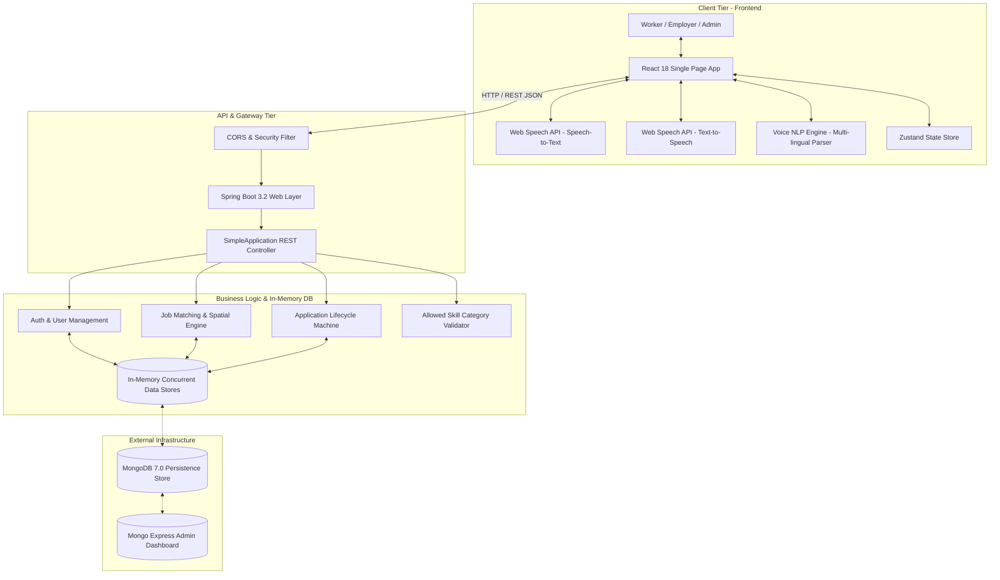
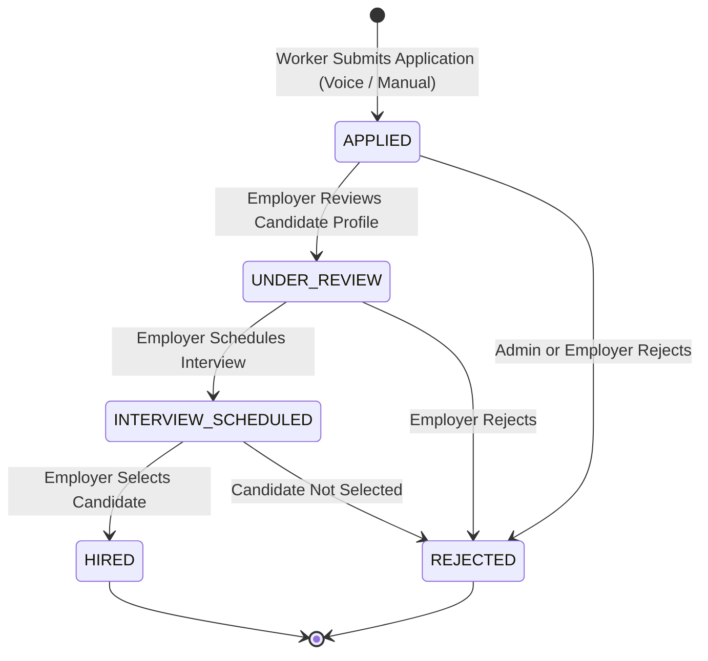
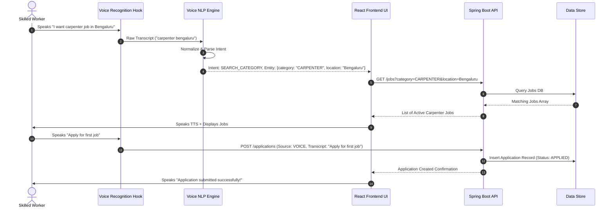

# VoiceHire Architecture & System Design

## 1. Executive Summary

VoiceHire (Udyoga Mitra) is an accessible, multi-lingual, voice-first hiring platform engineered specifically for low-literacy skilled blue-collar workers (e.g., drivers, carpenters, plumbers, painters, electricians, masons, cooks) and regional employers across India.

The platform bridges the literacy gap by enabling end-to-end voice-driven job search, profile registration, audio application submission, and interview tracking.

---

## 2. High-Level Architecture Diagram

---

## 3. Core System Components

### 3.1 Frontend Architecture (`/frontend`)
- **Framework**: React 18 boosted by Vite for ultra-fast hot module replacement.
- **Routing**: React Router 6 providing responsive view orchestration for Worker, Employer, and Admin portals.
- **Voice Subsystem**:
  - `useVoiceRecognition.js`: Custom hook interfacing with browser `webkitSpeechRecognition` or native Speech API.
  - `voiceNLP.js`: Local rule-assisted Natural Language Processing engine supporting 5 languages (`kn-IN`, `hi-IN`, `te-IN`, `ta-TN`, `en-IN`). Parses spoken voice inputs into intent (`SEARCH_CATEGORY`, `APPLY_JOB`, `CHECK_APPLICATION_STATUS`, `CONFIRM`, `CANCEL`) and extracts entities (job categories and geographical cities).
- **State Management**: Zustand store for client-side authentication, pending voice recordings, and active filters.

### 3.2 Backend Architecture (`/backend`)
- **Framework**: Spring Boot 3.2.0 executing on Java 17 LTS.
- **Controller & Service Layer**: `SimpleApplication.java` handles REST endpoints, low-literacy category validation, geographic distance calculation (Haversine formula), and in-memory transactional database operations (`USERS_DB`, `JOBS_DB`, `APPLICATIONS_DB`).
- **Category Enforcement**: Enforces `ALLOWED_CATEGORIES` (18 skilled worker categories), automatically rejecting corporate/white-collar postings to maintain platform focus.

---

## 4. Application Status Lifecycle Machine

---

## 5. Sequence Diagram: Voice Application Flow

---

## 6. Key Design Decisions

1. **Voice-First Accessibility**: Voice input & audio feedback are primary UI elements rather than secondary additions, enabling non-literate workers to browse and apply without typing.
2. **Strict Category Guardrails**: Excludes corporate/office jobs to guarantee relevant listings for skilled blue-collar trade workers.
3. **Multi-Lingual Synonyms**: NLP engine uses comprehensive phonetic and regional script dictionaries (Kannada, Hindi, Telugu, Tamil, English) to match local spoken terms to standardized job codes.
