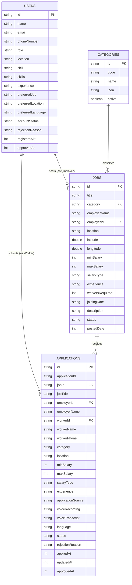

# VoiceHire Database Schema Specification

## 1. Overview

VoiceHire uses a document-oriented database model (MongoDB 7.0 / JSON Data Store). The schema prioritizes fast read performance for job searches, multi-lingual keyword queries, and application history lookups for low-literacy skilled workers.

---

## 2. Entity Relationship Diagram (ERD)

---

## 3. Detailed Data Schemas

### 3.1 `users` Collection / `USERS_DB`

Stores profile details for Workers, Employers, and Admins.

| Field Name | Type | Required | Default | Description |
|---|---|---|---|---|
| `id` | String | Yes | `user_{uuid}` | Unique Identifier (or `worker_1`, `admin_1`) |
| `name` | String | Yes | `""` | User's full name |
| `email` | String | No | `null` | Lowercase unique email address |
| `phoneNumber` | String | Yes | `""` | 10-digit primary phone number |
| `role` | String | Yes | `"WORKER"` | Enum: `WORKER`, `EMPLOYER`, `ADMIN` |
| `location` | String | No | `"Bengaluru"` | Primary location / home city |
| `skill` | String | No | `"DRIVER"` | Primary trade skill code |
| `skills` | String | No | `""` | Descriptive trade skills (e.g. `Wood Carpenter`) |
| `experience` | String | No | `"2 Years"` | Experience duration string |
| `preferredJob` | String | No | `""` | Preferred job title / trade |
| `preferredLocation` | String | No | `"Bengaluru"` | Desired work location |
| `preferredLanguage` | String | No | `"kn-IN"` | IETF BCP 47 tag (`kn-IN`, `hi-IN`, `te-IN`, `ta-TN`, `en-IN`) |
| `accountStatus` | String | Yes | `"PENDING"` | Enum: `PENDING`, `APPROVED`, `REJECTED` |
| `rejectionReason` | String | No | `null` | Admin reason if account registration rejected |
| `registeredAt` | Long | Yes | Timestamp | Unix epoch timestamp (ms) |
| `approvedAt` | Long | No | Timestamp | Unix epoch timestamp (ms) |

---

### 3.2 `jobs` Collection / `JOBS_DB`

Stores skilled trade job vacancies posted by employers.

| Field Name | Type | Required | Default | Description |
|---|---|---|---|---|
| `id` | String | Yes | `job_{uuid}` | Unique Job ID |
| `title` | String | Yes | `""` | Descriptive title (with multi-lingual subtitles) |
| `category` | String | Yes | N/A | Must match `ALLOWED_CATEGORIES` (e.g., `CARPENTER`) |
| `employerName` | String | Yes | `""` | Business / Employer display name |
| `employerId` | String | Yes | `""` | ID of the employer user |
| `location` | String | Yes | `""` | Work location city |
| `latitude` | Double | No | `12.9716` | WGS84 latitude coordinate |
| `longitude` | Double | No | `77.5946` | WGS84 longitude coordinate |
| `minSalary` | Integer | Yes | `0` | Minimum salary amount (INR) |
| `maxSalary` | Integer | Yes | `0` | Maximum salary amount (INR) |
| `salaryType` | String | Yes | `"DAILY"` | Enum: `DAILY`, `MONTHLY`, `WEEKLY` |
| `experience` | String | No | `"1 year"` | Minimum required experience |
| `workersRequired` | Integer | Yes | `1` | Number of open vacancies |
| `joiningDate` | String | No | `"Immediate"` | Target joining timeline |
| `description` | String | Yes | `""` | Detailed job requirements & wage details |
| `status` | String | Yes | `"ACTIVE"` | Enum: `ACTIVE`, `CLOSED` |
| `postedDate` | Long | Yes | Timestamp | Unix epoch timestamp (ms) |

---

### 3.3 `applications` Collection / `APPLICATIONS_DB`

Tracks worker job applications, voice transcripts, and employer status decisions.

| Field Name | Type | Required | Default | Description |
|---|---|---|---|---|
| `id` | String | Yes | `app_{uuid}` | Unique Application ID |
| `jobId` | String | Yes | N/A | Reference to `jobs.id` |
| `jobTitle` | String | Yes | `""` | Denormalized job title for fast UI rendering |
| `employerId` | String | Yes | `""` | Reference to employer |
| `employerName` | String | Yes | `""` | Denormalized employer name |
| `workerId` | String | Yes | N/A | Reference to `users.id` |
| `workerName` | String | Yes | `""` | Denormalized candidate worker name |
| `workerPhone` | String | Yes | `""` | Contact phone number for candidate |
| `category` | String | Yes | `""` | Job trade category |
| `applicationSource`| String | Yes | `"MANUAL"` | Enum: `VOICE`, `MANUAL` |
| `voiceRecording` | String | No | `""` | URL or base64 audio snippet |
| `voiceTranscript` | String | No | `""` | Transcribed voice text spoken by worker |
| `language` | String | No | `"en-IN"` | Speech recognition language tag |
| `status` | String | Yes | `"APPLIED"` | Enum: `APPLIED`, `UNDER_REVIEW`, `INTERVIEW_SCHEDULED`, `HIRED`, `REJECTED`, `ACCEPTED` |
| `interviewDate` | String | No | `null` | Date of scheduled interview |
| `interviewTime` | String | No | `null` | Time of scheduled interview |
| `interviewLocation`| String | No | `null` | Physical venue or phone call instructions |
| `rejectionReason` | String | No | `null` | Reason if candidate was rejected |
| `appliedAt` | Long | Yes | Timestamp | Unix epoch timestamp (ms) |
| `updatedAt` | Long | Yes | Timestamp | Unix epoch timestamp (ms) |

---

### 3.4 `categories` Collection / `CATEGORIES_LIST`

Lookup collection for low-literacy trade categories.

| Field Name | Type | Required | Description |
|---|---|---|---|
| `id` | String | Yes | Category code (e.g. `DRIVER`, `CARPENTER`, `PLUMBER`) |
| `code` | String | Yes | Uppercase category identifier |
| `name` | String | Yes | Localized category display string with regional scripts |
| `icon` | String | Yes | Visual emoji icon for non-literate navigation |
| `active` | Boolean | Yes | Operational toggle |

---

## 4. Indexing Recommendations

When deploying on MongoDB:
1. `users`: Index on `{ phoneNumber: 1 }`, `{ email: 1 }`, `{ accountStatus: 1 }`
2. `jobs`: Index on `{ category: 1, status: 1 }`, `{ location: 1 }`, 2DSphere index on `{ latitude: 1, longitude: 1 }`
3. `applications`: Index on `{ workerId: 1, jobId: 1 }` (unique compound index), `{ employerId: 1 }`, `{ status: 1 }`
