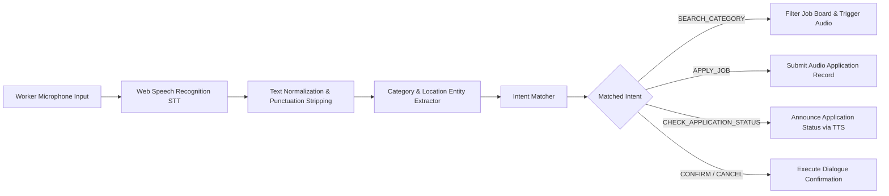

# VoiceHire Voice Command & Speech Engine Guide

## 1. Overview

VoiceHire (Udyoga Mitra) features a multi-lingual, voice-first interaction engine designed to allow low-literacy skilled workers to navigate jobs, filter categories by trade, state locations, check application statuses, and apply for jobs hands-free using spoken commands.

The engine relies on Web Speech API (`webkitSpeechRecognition` & `speechSynthesis`) integrated with a local natural language rule parser (`voiceNLP.js`).

---

## 2. Supported Regional Languages

| Language Tag | Language Name | Script | Voice Search & TTS Support |
|---|---|---|---|
| `kn-IN` | Kannada (ಕನ್ನಡ) | Kannada Script | ✅ Fully Supported (Default) |
| `hi-IN` | Hindi (हिंदी) | Devanagari Script | ✅ Fully Supported |
| `te-IN` | Telugu (తెలుగు) | Telugu Script | ✅ Fully Supported |
| `ta-TN` | Tamil (தமிழ்) | Tamil Script | ✅ Fully Supported |
| `en-IN` | Indian English | Latin Script | ✅ Fully Supported |

---

## 3. Voice Intent Pipeline

---

## 4. Spoken Keyword Dictionary by Category

| Trade Category | English Keywords | Hindi Trigger Words | Kannada Trigger Words | Telugu / Tamil Triggers |
|---|---|---|---|---|
| **DRIVER** | driver, cab driver, car driver, auto driver | ड्राइवर, गाड़ी, चालक | ಚಾಲಕ, ಡ್ರೈವರ್ | చాలక, డ్రైవర్ / ஓட்டுநர் |
| **CARPENTER** | carpenter, wood worker, furniture | बढ़ई, कारपेंटर | ಬಡಗಿ, ಮರಗೆಲಸ | వడ్రంగి, కార్పెంటర్ / தச்சர் |
| **PAINTER** | painter, wall painter, painting | पेंटर, पुताई | ಪೇಂಟರ್, ಬಣ್ಣ | పెయింటర్, రంగులు / பெயிண்டர் |
| **ELECTRICIAN** | electrician, wiring, electrical | इलेक्ट्रीशियन, बिजली | ಇಲೆಕ್ಟ್ರೀಷಿಯನ್, ವೈರಿಂಗ್ | ఎలక్ట్రీషియన్, కరెంట్ / எலக்ட்ரீஷியன் |
| **PLUMBER** | plumber, pipe worker, tap repair | प्लम्बर, नल | ಪ್ಲಂಬರ್, ಪೈಪ್ | ప్లంబర్, పైపులు / பிளம்பர் |
| **MASON** | mason, brick worker, construction | राजमिस्त्री, मिस्त्री | ಮೇಸ್ತ್ರಿ, ಗಾರೆ | మేస్త్రీ, ఇటుక / கொத்தனார் |
| **COOK** | cook, chef, rasoi | रसोइया, खाना | ಅಡುಗೆಯವ, ಅಡುಗೆ | వంట మనిషి, వంట / சமையல்காரர் |
| **CLEANER** | cleaner, housekeeper, sweeper | सफाई वाला, घरेलू | ಸ್ವಚ್ಛತಾಗಾರ, ಸಫಾಯಿ | సఫాయి, శుభ్రం / துப்புரவாளர் |
| **MECHANIC** | mechanic, bike repair, auto repair | मेकेनिक, रिपेयर | ಮೆಕ್ಯಾನಿಕ್ | మెకానిక్, రిపేర్ / மெக்கானிக் |
| **WELDER** | welder, iron worker, welding | वेल्डर | ವೆಲ್ಡರ್ | వెల్డర్ / வெல்டர் |
| **SECURITY_GUARD**| security guard, guard, watchman | सुरक्षा गार्ड, चौकीदार | ಸೆಕ್ಯೂರಿಟಿ ಗಾರ್ಡ್ | సెక్యూరిటీ గార్డ్ / பாதுகாவலர் |
| **DELIVERY_WORKER**| delivery, rider, delivery boy | डिलीवरी | ಡೆಲಿವರಿ | డెలివరీ / டெலிவரி |
| **FARM_WORKER** | farm worker, farmer, agriculture | किसान, खेती | ರೈತ, ಕೃಷಿ | రైతు, వ్యవసాయం / விவசாய |
| **TAILOR** | tailor, stitching, garment | दर्जी, सिलाई | ದರ್ಜಿ, ಹೊಲಿಗೆ | దర్జీ, కుట్టు / தையல்காரர் |

---

## 5. Location Entity Triggers

| Target City | Recognized Spoken Variations |
|---|---|
| **Bengaluru** | `bengaluru`, `bangalore`, `ಬೆಂಗಳೂರು`, `बेंगलुरु`, `బెంగళూరు`, `பெங்களூரு` |
| **Mysuru** | `mysuru`, `mysore`, `ಮೈಸೂರು`, `मैसूर`, `మైసూర్`, `மைசூர்` |
| **Mangaluru** | `mangaluru`, `mangalore`, `ಮಂಗಳೂರು`, `मंगलौर`, `మంగళూరు`, `மங்களூரு` |
| **Hubballi** | `hubballi`, `hubli`, `ಹುಬ್ಬಳ್ಳಿ`, `हुबली`, `హుబ్పళ్ళి`, `ஹூப்ளி` |
| **Tumakuru** | `tumakuru`, `tumkur`, `ತುಮಕೂರು`, `तुमकुर`, `తుమకూరు`, `தும்கூர்` |

---

## 6. Voice Intent Definitions & Sample Utterances

### 6.1 `SEARCH_CATEGORY`
- **Sample Spoken Inputs**:
  - *"I want driver job in Bengaluru"*
  - *"मुझे मैसूर में कारपेंटर का काम चाहिए"*
  - *"ನನಗೆ ಬೆಂಗಳೂರಿನಲ್ಲಿ ಮರಗೆಲಸ ಕೆಲಸ ಬೇಕು"*
- **System Action**: Filters active job listings matching category and city entity, and reads out top results via Text-to-Speech (TTS).

### 6.2 `APPLY_JOB`
- **Sample Spoken Inputs**:
  - *"Apply for this job"*
  - *"इस काम के लिए आवेदन करें"*
  - *"ಈ ಕೆಲಸಕ್ಕೆ ಅರ್ಜಿ ಹಾಕಿ"*
- **System Action**: Extracts current active job ID, attaches worker ID, stores audio transcript, and posts to `/applications`.

### 6.3 `CHECK_APPLICATION_STATUS`
- **Sample Spoken Inputs**:
  - *"What is status of my application?"*
  - *"ನನ್ನ ಅರ್ಜಿಯ ಸ್ಥಿತಿ ಏನು?"*
  - *"मेरे आवेदन की स्थिति क्या है?"*
- **System Action**: Queries `/applications/my` and announces application status (e.g. `APPLIED`, `INTERVIEW_SCHEDULED`, `HIRED`).

---

## 7. Accessibility & Audio Feedback Best Practices

1. **Visual Audio Wave Indicator**: Displays dynamic wave animation during voice input so non-literate workers know the microphone is active.
2. **Read-Aloud (TTS) Prompts**: Reads out job title, daily/monthly wages, and location in candidate's selected language.
3. **Offline Fallback Notice**: If browser lacks Speech API or web connection drops, displays clear high-contrast icon buttons with audio click previews.
